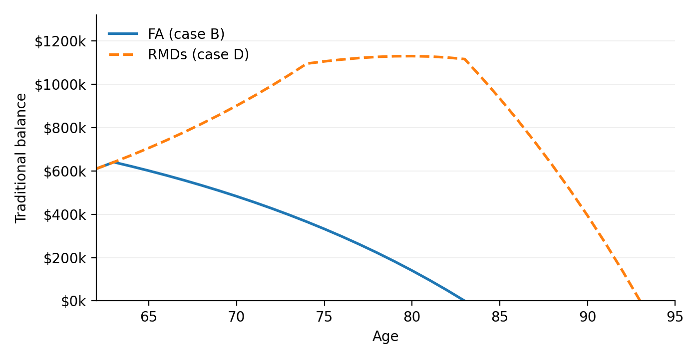

# Bottom-Up Roth Conversion Valuation: The Distribution Tax Rate as an Output

**Steven Cheshire, CFA**
Draft: 2026-09-11

---

## 1. Rate Arbitrage: From Assumed to Derived Distribution Rates

Roth conversion valuation typically compares the conversion rate $t_C$ with an assumed distribution rate $t_D$, an input that drives the decision.

This paper takes the opposing view. A conversion can only be valued directly. Specify a finite distribution schedule carrying the account to zero; compute each year's Traditional and Roth distributions and federal tax liabilities with and without the conversion; and sum the present-value (PV) differences in after-tax cash flow:

$$\alpha_{\text{Rate Arb}} = \sum_{t=1}^{N} \frac{\Delta\mathrm{ATCF}_t}{(1+r)^t}$$

There is no $t_D$ input. The output is a conversion-specific rate on the Traditional distributions displaced by converting $C$:

$$t_D(C) = \frac{\mathrm{PV}\bigl[-\Delta\mathrm{Tax}\bigr]}{\mathrm{PV}\bigl[-\Delta D^T\bigr]}$$

It cannot be known independently of the path it summarizes. **The calculation an assumed $t_D$ tries to avoid is the calculation required to produce it.**

But the familiar formula is recovered as a reconciliation identity when the schedule terminates at zero. Discounted at the portfolio rate, the following holds exactly:

$$\alpha_{\text{Rate Arb}} = \mathrm{PV}(\Delta\mathrm{ATCF}) = C\,\bigl[t_D(C) - t_C(C)\bigr]$$

The same annual calculation supplies the inputs for the conversion's other effects: the MAGI path that sets Medicare surcharges, and the after-tax displaced distributions that set RMD-reduction tax drag. Because the schedule closes, each is a finite present value priced from the path, with no assumed rate.

$t_D(C)$ and $\alpha_{\text{Rate Arb}}$ are cumulative, averaged over every bracket the conversion fills. But the decision is incremental: each bracket brings its own cash flows, alpha, and derived rate. Incremental alphas show which bracket the rate-arbitrage optimum fills through; an assumed $t_D$ cannot. **The distribution tax rate is not an input to be improved; it is a conversion-specific output to be reported.**

---

## 2. The Closed Distribution Schedule

### 2.1 Two schedules

A distribution schedule specifies, for every year, what fraction of the remaining balance leaves the account.

**Fixed Annuity (FA).** A household drawing the account for income takes the largest level payment the balance will sustain:

$$D = B_0 \cdot \mathrm{AF}(r, N), \qquad \mathrm{AF}(r, N) = \frac{r}{1 - (1+r)^{-N}}$$

The balance evolves as $B_t = B_{t-1}(1+r) - D$ and reaches zero at $t = N$.

**RMDs.** A household not needing the income takes the statutory minimum, $D_t = B_{t-1} / \varepsilon_t$, where $\varepsilon_t$ is the Uniform Lifetime Table divisor. The balance rises while $1/\varepsilon_t < r$ and falls thereafter. The beneficiary period carries the remainder to zero.

> **Figure 1.** A \$610,000 Traditional balance under the two schedules at $r$. FA depletes from ages 64–83; RMD balance accumulates until age 75, peaks at 80, and depletes at 93 after the beneficiary decade.

What matters is not the shape of a schedule's trajectory but that it terminates at zero.

### 2.2 Closure

A schedule is **closed** when it depletes the account: $B_N = 0$. Dividing $B_t = B_{t-1}(1+r) - D_t$ by $(1+r)^t$ and collecting balances on the left gives

$$\frac{B_t}{(1+r)^t} - \frac{B_{t-1}}{(1+r)^{t-1}} = -\frac{D_t}{(1+r)^t}$$

Summing over $t = 1, \ldots, N$, the left telescopes to $B_N/(1+r)^N - B_0$. Setting $B_N = 0$ gives

$$B_0 = \sum_{t=1}^{N} \frac{D_t}{(1+r)^t}$$

**For a closed schedule discounted at the rate the balance earns, the present value of its distributions is its initial balance.**

Consequently, every dollar affected by the conversion eventually appears in the distribution stream, and every effect of the conversion falls within the horizon. The present value of the resulting $\Delta\mathrm{ATCF}_t$ is therefore the entire rate-arbitrage wealth change created at conversion, and each component of §3.3 is likewise a finite present value, with no terminal balance left to value at an assumed rate.

A schedule that stops at a planning horizon with money still in the account is not closed. Discounted distributions fall short of $B_0$ by the discounted terminal balance, and valuing that balance requires an assumed future tax rate. §7.4 shows where this occurs in planning tools.

---

## 3. Bottom-Up Valuation

The model assumes a return, inflation, tax-law path, longevity, and distribution schedule, but no *aggregate* tax rate. Taxes are computed annually under the applicable statutory rules; the rates reported in §4 are outputs of that computation.

### 3.1 The annual tax calculation

For each year $t$, in order:

$$D^T_t + \text{other income} \;\rightarrow\; \mathrm{PI}_t \;\rightarrow\; \text{taxable Social Security} \;\rightarrow\; \text{taxable income} \;\rightarrow\; \mathrm{Tax}_t$$

The Roth distribution enters none of these; it is tax-free and affects only cash flow.

Provisional income (PI) is ordinary income plus tax-exempt interest plus half the Social Security benefit; §6 gives the schedule that turns it into taxable Social Security. The standard deduction, the additional deduction from age 65, and the bracket thresholds all inflate at the assumed rate. The conversion-year standard deduction is \$16,100, which defines the first conversion increment examined throughout.

The same engine computes conversion-year and distribution-year tax, so both $t_C(C)$ and $t_D(C)$ emerge from annual statutory calculations rather than assumed aggregate rates.

### 3.2 The annual change in after-tax cash flow

Run the schedule twice — once with the conversion, once without — and difference the results year by year:

$$\Delta\mathrm{ATCF}_t = \Delta D^T_t + \Delta D^R_t - \Delta\mathrm{Tax}_t$$

$\Delta\mathrm{Tax}_t$ is the change in the household's federal tax liability between the two paths, including any change in the tax on other income. The Traditional distribution falls, because the balance it is drawn from is smaller. The Roth distribution rises by the same fraction of a larger balance. Federal tax falls, because only the Traditional distribution is taxable.

Medicare surcharges and taxable-account drag are excluded from $\Delta\mathrm{ATCF}_t$ (§3.3).

### 3.3 The rate-arbitrage alpha

The rate-arbitrage alpha is the present value of that stream (§1), a finite sum. It is the Core's present value: because the Core settles the tax inside the account, $\alpha$ already nets the conversion tax and requires no separate outlay term. Every term is computed by the calculation above.

The annual paths also provide the inputs needed to value separate conversion effects without additional tax-rate assumptions. The MAGI path determines Medicare surcharges, while displaced Traditional distributions net of their year-specific taxes determine RMD-reduction tax drag; substituting $t_D(C)$ for those annual rates would replace the underlying path with the average derived from it, an error Cheshire (forthcoming) measures at up to 3.5% of the RMD-reduction alpha. Because the schedule is closed (§2.2), each is the present value of a finite stream: surcharges run from two years after conversion through the owner's lifetime, and the drag's taxable counterfactual is drawn to zero on the same schedule. These components are separate from rate arbitrage and are not developed here.

---

## 4. Deriving the Distribution Tax Rate

Nothing so far has required a distribution tax rate: the alpha of §3.3 was computed from annual differences alone. Only now, with the computation complete, is $t_D$ defined — *from* the result rather than supplied *to* it.

### 4.1 Definition

$$t_D = \frac{\displaystyle\sum_{t=1}^{N} \frac{-\Delta \mathrm{Tax}_t}{(1+r)^t}}{\displaystyle\sum_{t=1}^{N} \frac{-\Delta D^T_t}{(1+r)^t}}$$

Throughout, differences are conversion minus no-conversion, so both deltas are negative and the minus signs make each quantity positive: **tax avoided per dollar of Traditional distribution displaced**, weighted by when the dollars occur.

The per-year effective rate $-\Delta\mathrm{Tax}_t / -\Delta D^T_t$ is reported year by year in §6, where case B's displaced dollars are taxed at 22.0%, 22.2% or 40.7% depending on the year; $t_D$ is its present-value-weighted aggregate, 30.6% for that conversion. A conversion whose displaced dollars arrive early is worth more than one whose arrive late, and an unweighted average would price those identically. The annual rates show where the value comes from; $t_D$ is what reconciles to the alpha.

**Closure simplifies the denominator.** By §2.2 the present value of the displaced Traditional distributions is exactly $C$, so $t_D(C)$ is the present value of tax avoided divided by $C$. The denominator is not an empirical quantity to be measured; it is the conversion amount, by closure.

**Two rates.** The **cumulative** rate $t_D(C)$ applies to everything a conversion of $C$ displaces. The **finite-increment** rate $t_D^{\Delta}(C_1, C_2)$ is the additional tax avoided between two conversion sizes divided by the additional amount converted; since a conversion of zero avoids no tax, the cumulative rate is the increment from $0$ to $C$. Table 1 reports the first, Table 2 the second.

Both are averages. A bracket-width increment can contain a Social Security threshold crossing, so even Table 2's figures conceal variation within the increment. The underlying marginal rate, and how these averages relate to it, are treated in §A.6.

### 4.2 The reconciliation identity

Closure (§2.2) converts the conversion's two balance-sheet effects into two present-value facts. The Traditional balance falls by $C$ and the Roth balance rises by $C - K$; each account then distributes its whole balance over the schedule, so

$$\mathrm{PV}\bigl(-\Delta D^T\bigr) = C, \qquad \mathrm{PV}\bigl(\Delta D^R\bigr) = C - K$$

and the change in gross distributions has present value $-K$ — the tax, and nothing else.

By the definition in §4.1, $\mathrm{PV}(-\Delta \mathrm{Tax}) = C \, t_D$. Therefore

$$\mathrm{PV}(\Delta \mathrm{ATCF}) = \underbrace{-C + (C-K)}_{\text{gross distributions}} + \underbrace{C\,t_D(C)}_{\text{tax avoided}} = -K + C\,t_D(C) = C\,\bigl[t_D(C) - t_C(C)\bigr]$$

using $K = C\,t_C$.

**The conventional expression is recovered exactly, as a consequence rather than an assumption.** No multiple, no approximation, no adjustment term. The same result follows from the conversion-date balance sheet, before any distribution occurs (§A.7).

Both closure conditions and the identity itself hold exactly against the computed schedule; Appendix B gives the figures. The identity is a theorem with a hypothesis, and the hypothesis is closure (§2.2).

---

## 5. Worked Example: Cumulative and Incremental Valuation

### 5.1 Household and assumptions

| | |
|---|---|
| Filing status | Single, born 1964 |
| Conversion | 2026, age 62 |
| Social Security begins | age 64 |
| Distributions | from age 64, FA, twenty years |
| Portfolio return $r$ | 5.00% |
| Inflation and Social Security COLA | 1.50% |
| Other taxable income | none, in conversion and distribution years |
| Roth balance at conversion | \$0 |
| Reinvestment of distributions | none |

Four cases use this common profile to isolate the effects examined below.

| | Traditional balance | Social Security | Annual distribution | What it establishes |
|---|--------------|----------|--------------|------------------------------------------|
| **A** | \$900,000 | \$40,000 | \$75,829 | The control: $t_D$ is the statutory rate |
| **B** | \$610,000 | \$40,000 | \$51,395 | The principal result |
| **C** | \$610,000 | \$20,000 | \$51,395 | Attribution: the benefit is the cause |
| **D** | \$610,000 | \$40,000 | RMDs | Schedule dependence |

Cases A, B and C hold the schedule fixed and vary one household characteristic. Case D instead holds the household of B fixed and varies the schedule, taking RMDs from age 75 across nine owner years followed by ten-year beneficiary depletion. Twelve years of accumulation precede it, so the account is emptied thirty-one years after the conversion. Beneficiary other income is set at \$100,000.

Reinvestment is set to zero, so reported values isolate rate arbitrage.

Conversions throughout are sized to fill a statutory bracket. Because Social Security is not yet in payment in the conversion year, the conversion cannot draw benefits into taxable income, so the realized $t_C$ on each increment equals the statutory bracket rate.

### 5.2 Cumulative valuation: the choice set

A household faces a menu of conversions, indexed by how far up the bracket schedule it goes. Table 1 gives that menu for cases A and B.

**Table 1 — Cumulative conversions.** Conversion amount, conversion-year rate, distribution rate and rate-arbitrage alpha, by bracket filled.

| Bracket filled | &nbsp;$C$ | &nbsp;$t_C(C)$ | A: $t_D(C)$ | A: $\alpha$ | B: $t_D(C)$ | B: $\alpha$ |
|--------------|--------:|-------:|----------:|--------:|----------:|--------:|
| Deduction | \$16,100 | 0.0% | 22.0% | \$3,542 | 30.9% | \$4,975 |
| 10% | \$28,500 | 4.4% | 22.0% | \$5,030 | 32.1% | \$7,922 |
| 12% | \$66,500 | 8.7% | 22.0% | **\$8,830** | 33.7% | \$16,599 |
| 22% | \$121,800 | 14.8% | 22.0% | **\$8,830** | 30.6% | **\$19,351** |
| 24% | \$217,875 | 18.8% | 22.0% | \$6,909 | 26.9% | \$17,639 |
| 32% | \$272,325 | 21.5% | 22.2% | \$2,086 | 26.0% | \$12,303 |

$C$ and $t_C$ are common to both cases by construction rather than coincidence: the conversion-year liability depends on the amount converted and on conversion-year income, neither of which involves the Traditional balance, and neither household is drawing Social Security when it converts (§5.1). **The entire difference between the two alpha columns is $t_D$.**

Two features are worth naming before §5.3 accounts for them. A's rate is 22.0% at every fill, while B's rises to 33.7% and then falls. And A's alpha is the same \$8,830 at two consecutive fills — a plateau in the cumulative view means the increment between those points is worth exactly nothing, which is where the marginal view begins.

### 5.3 Incremental valuation and the stopping rule

Table 1 does not say where to stop. For that, each bracket must be priced against the one below it rather than against no conversion at all.

**Table 2 — Bracket increments.** The effect of adding each bracket. Rates here are the finite-increment $t_D^{\Delta}(C_1, C_2)$ of §4.1, not the cumulative $t_D(C)$ of Table 1.

| Bracket added | &nbsp;$C$ | &nbsp;$t_C$ | A: $t_D^{\Delta}$ | A: $\alpha$ | B: $t_D^{\Delta}$ | B: $\alpha$ |
|--------------|--------:|-------:|----------:|--------:|----------:|--------:|
| Deduction | \$16,100 | 0.0% | 22.0% | \$3,542 | 30.9% | \$4,975 |
| 10% | \$12,400 | 10.0% | 22.0% | \$1,488 | 33.8% | \$2,946 |
| 12% | \$38,000 | 12.0% | 22.0% | \$3,800 | **34.8%** | **\$8,678** |
| 22% | \$55,300 | 22.0% | 22.0% | **\$0** | 27.0% | \$2,752 |
| 24% | \$96,075 | 24.0% | 22.0% | −\$1,921 | 22.2% | −\$1,713 |
| 32% | \$54,450 | 32.0% | 23.1% | −\$4,822 | 22.2% | −\$5,336 |

**Case A is the degenerate case.** Its increments are 22.0% at every bracket through the 24%, so its cumulative rate is 22.0% as well — averaging a constant returns the constant. The two tables agree column for column, and neither moves.

**Case B is the general case.** Its increments run 30.9, 33.8, 34.8, 27.0, 22.2, 22.2; its cumulative rates run 30.9, 32.1, 33.7, 30.6, 26.9, 26.0. The cumulative peaks lower than the increment, 33.7% against 34.8%, and one fill later, because an average lags what it averages. A planner who read Table 1's 33.7% as the rate on the 12% bracket would understate it.

**The stopping points differ.** A's last profitable increment is the 12% bracket: its 22% increment prices at exactly \$0, because $t_C$ has risen to meet a flat $t_D$ of 22.0%. B's last profitable increment is the 22% bracket, at +\$2,752. The smaller account converts further, and earns more at every step — \$8,678 against \$3,800 on the 12% bracket alone.

Cumulative alpha stays positive well past the point where marginal alpha turns negative. B still shows \$12,303 at the 32% fill while the 32% increment itself destroyed \$5,336 — which is precisely how "convert to the top of the 24% bracket" survives as advice.

The source of case B's high and non-monotonic rates is examined in §6.

### 5.4 The decision metric

Under the Core Conversion no outside capital is deployed. There is no year-zero outflow, and consequently no internal rate of return: the cash-flow stream has no sign change to solve against. Software that reports one for an inside-funded conversion is reporting a sign flag, not a return.

The decision metric is the present value itself. A conversion increment with positive $\alpha$ raises the household's after-tax wealth at the discount rate $r$; one with negative $\alpha$ lowers it. The household converts while the marginal increment is positive and stops when it is not. Rate of return re-enters only under outside funding, which supplies an outlay for a return to be earned on (§A.5).

---

## 6. The Social Security Torpedo

### 6.1 The result

The argument of §1 through §4 does not depend on Social Security: both rates are outputs — $t_D(C)$ of the distribution schedule, $t_C(C)$ of the conversion-year tax calculation — for any household. What Social Security supplies is a case where no bracket-based reasoning arrives at the right answer, and where the result runs against the direction of conventional advice.

Conversions are ordinarily aimed at the largest accounts. On the identical conversion of \$121,800, filling through the 22% bracket at an identical conversion tax rate of 14.75%, case A earns **\$8,830** and case B — whose account is a third smaller — earns **\$19,351**. The entire difference is $t_D$: 22.00% against 30.64%.

### 6.2 The mechanism

Taxable Social Security is the whole of it. Subject to a ceiling of 85% of the benefit, a single filer's taxable portion is:

$$
\text{taxable SS} =
\begin{cases}
0 & \mathrm{PI} \le \$25{,}000 \\[2pt]
0.50\,(\mathrm{PI} - \$25{,}000) & \$25{,}000 < \mathrm{PI} \le \$34{,}000 \\[2pt]
\$4{,}500 + 0.85\,(\mathrm{PI} - \$34{,}000) & \mathrm{PI} > \$34{,}000
\end{cases}
$$

**Social Security amplifies the marginal tax rate.** Raising the Traditional distribution one dollar can increase AGI by \$1.50 or \$1.85. The effective marginal tax rate on that dollar is therefore 1.50 or 1.85 times the statutory rate: 12% becomes 22.2%, 22% becomes 40.7%. Once the 85% taxable-benefit ceiling binds, the amplification ends and the effective rate returns to the statutory rate.

**The thresholds are not indexed.** Unlike tax brackets and deductions, the \$25,000 and \$34,000 thresholds remain fixed as Social Security benefits rise with COLAs. A household can therefore cross a threshold over time without any change in real income.

**Table 3 — The same conversion in two households.** \$121,800 converted, twenty distribution years.

| | A | B |
|--------------------------------------|---------------------|---------------------|
| PI, pre-conversion | \$95,829 → \$102,368 | \$71,395 → \$77,934 |
| PI, post-conversion | \$85,567 → \$92,106 | \$61,133 → \$67,672 |
| Ceiling at which 85% becomes taxable | \$68,707 → \$81,785 | \$68,707 → \$81,785 |
| Benefit taxed, pre → post | 85% → 85% | 85% → 62% |
| Taxable Social Security displaced | \$0 in every year | \$6,438 → \$8,723 |
| Marginal rate on displaced dollars | 22.0% throughout | 22.2% to 40.7% |
| $t_D$ | 22.00% | 30.64% |

A's PI is above the ceiling in every year, before and after. The conversion lowers it by about \$10,000 and it remains above. Nothing happens: the benefit stays 85% taxable, no Social Security is displaced, and each displaced dollar is taxed at the statutory rate and no more.

B's PI starts above the ceiling and the conversion pushes it below for the entire schedule. Every displaced dollar therefore does two things — it removes ordinary income, and it removes taxable Social Security along with it. The marginal rate on those dollars is 1.50 or 1.85 times the statutory rate.

The ceiling rises faster than B's pre-conversion income, so from 2037 the household enters the phase-in region *without* converting. From that year the top of the displaced band is 22% × 1.85 = 40.7% while the bottom remains 12% × 1.85 = 22.2%. Two statutory brackets produce four realized rates.

### 6.3 Attribution

Case C halves the benefit to \$20,000 and changes nothing else — same account, same conversion amounts, same schedule, same $t_C$.

$t_D^{\Delta}$ collapses to a flat **12.0%** across the deduction, 10% and 12% increments, and the alphas fall from +\$4,975 / +\$2,946 / +\$8,678 to +\$1,932 / +\$248 / \$0. Case C's last strictly profitable increment is the 10% bracket; adding the 12% is value-neutral. B converts through the 22%.

Half the benefit means half the PI at risk, and B's conversion no longer moves it far enough to matter. **The effect belongs to the benefit, not to the account** — which means the households exposed are those whose benefit is large relative to their distributions, a condition on the ratio rather than on wealth.

### 6.4 What the aggregate conceals

A planner estimating this household's distribution rate would read a statutory bracket — 22% before the conversion, 12% after — and take one of them. The schedule produces **30.64%**: an error of nine to nineteen percentage points depending on which bracket is read, in the direction of systematic under-conversion.

**Realized marginal rates are not bounded by the statutory schedule.** The multiplier applies to the statutory rate, so a dollar in the 22% bracket inside the phase-in region is taxed at 40.7% — above the highest rate in the federal code. Nor is the aggregate recoverable from any one year: it depends on when the displaced dollars arrive as well as how heavily they are taxed. It stays below 37% in the cases here because the conversion occurs at 62 and exposure is limited by construction; a household already drawing Social Security when it converts is exposed across more of its schedule.

### 6.5 Schedule dependence

Case D holds the household of B fixed and changes only the drawdown: RMDs from 75, nine owner years, then the beneficiary's ten-year depletion — a distinct closed schedule.

$t_D^{\Delta}$ falls from 30.9 / 33.8 / 34.8 / 27.0 to **24.9 / 25.0 / 24.9 / 24.4**, and cumulative alpha at the 22% fill from \$19,351 to \$12,128. The stopping point is unchanged — both stop at the 22% bracket — but the conversion is worth 37% less.

Deferring to 75 and compressing into ten years lifts the household above the ceiling for half the schedule. The underlying path is not flat, though: it still reaches 40.7%. What flattens is the aggregate, and a reader inferring a flat path from a flat aggregate would be wrong — the averaging relation of §4.1, read in reverse.

An RMD schedule also has a consequence the fixed-annuity cases do not. It leaves a balance at the owner's death, so closing it requires the beneficiary decade — and in those ten years the mechanism of this section is absent by construction. The owner's benefit has ceased, and the heirs' distributions are taxed against the heirs' own income alone. Because RMDs distribute only a fraction of the balance each year, the remainder passes to the heirs: **66% of the displaced distributions by present value — 61% of the alpha — fall after the owner's death.** That is the larger part of why E's aggregate is both lower and flatter than B's. Closure still holds exactly, and the heirs' income enters the tax function rather than standing in for a rate. But it is an input the household's own path does not generate, and for the majority of the conversion's value it is the only thing setting the rate.

---

## 7. Relation to Existing Frameworks

Existing treatments divide into two groups that reach the same place for opposite reasons. One recent framework sits between them, sharing the assumed rate of the first and the computed path of the second.

### 7.1 Frameworks that take $t_D$ as an input

Retail conversion calculators ask for a current tax rate and an expected retirement tax rate; the comparison between them is the calculator's entire logic.

**Reichenstein and Meyer (2017, 2020)** value conversions against a projected future bracket, recommending conversion when "the future tax bracket is reasonably *projected* to be higher."

**Kitces** states the requirement plainly: "calculating the future marginal tax rate requires making two key assumptions" — what other income the taxpayer will have, and how much of future pre-tax withdrawals the Roth can replace.

**Vanguard's BETR** (Passman, Wong and Dickson 2025) is the one framework that reports a *rate* as output, but the break-even is derived from assumed growth multiples rather than from a distribution schedule, and the decision still requires the user's own expected future rate to compare against it.

### 7.2 The closest prior work

**McQuarrie (2024)** is the closest prior work. He analyzes conversions as a net present value problem, discounts at the portfolio's expected appreciation because that is "the rate that makes the client indifferent to paying tax now versus later" — the argument of §A.4 — and runs the account to full depletion: RMDs to life expectancy, then ten years of distribution by heirs. He then verifies that the discounted tax savings over those twenty-seven years sum to the difference in tax rates times the distributions avoided: the reconciliation identity of §4.2, found empirically. Under a constant rate, however, the identity follows from closure alone: with $t_D$ fixed, the present value of tax avoided is $t_D$ times the present value of distributions displaced, which closure fixes at $C\,t_D$. The identity becomes a substantive claim when $t_D$ varies across the path, as it does whenever the rate is read from a bracket schedule rather than assumed.

What differs is the source of the rate. His is a constant assumed throughout — "there is no uncertainty or volatility in future tax rates; the 25 percent rate applies throughout the projection" — and its variability enters as uncertainty about the future, handled by scenario analysis. The claim here is different in kind: even under perfect foresight with the code fixed, $t_D$ is determined by the distribution path and varies with the size of the conversion. McQuarrie varies the rate exogenously; §6 shows it varying endogenously, from 34.8% to 22.2% across conversion sizes within a single household.

A second difference is one of accounting. McQuarrie's Table 1 arrives at the correct terminal rate-arbitrage value but presents a misleading path to it. The table charges the full outside tax payment at inception while recognizing the corresponding release of the Traditional account's embedded tax liability only as distributions occur. The resulting negative "NPV to this point" is therefore a cumulative cash-realization measure, not the household's net economic position. It creates the appearance that the taxpayer has made a long-term loan to the government, although no such asset or liability exists. At equal conversion and distribution rates the outside-funded conversion is a value-neutral migration of wealth from a taxable wrapper into the Roth — the wrapper result of McQuarrie and DiLellio (2023); at unequal rates the rate-arbitrage value exists upon conversion, although its cash realization occurs later. That later realization is not itself a cost: a tax-deferred account defers taxation across decades, and realizing an existing conversion benefit over the distribution schedule is the instrument operating as intended, not an additional economic cost.

### 7.3 Single-year effective marginal rates

The effective-marginal-rate calculation underlying the Social Security result of §6 is established: Reichenstein (2018) documents the mechanism and its consequences for retirees. Commercially, Covisum's Tax Clarity has for years produced a "tax map" tracing the effective marginal rate on each dollar of ordinary income, and publishes rates of 18.8%, 27.8%, 46.3% and 55.5% arising from precisely this interaction. None of that is claimed here.

Those tools answer a single-year question: *what is the effective marginal rate on my next dollar this year?* A conversion decision requires **which** years a household sits in the zone, for **how long**, and what the exposure **aggregates to** across the whole schedule — which a single-year view cannot supply, and which §4 turns into $t_D$.

### 7.4 Frameworks that compute the path

**Pralana, RightCapital, Boldin, Holistiplan, MaxiFi** and **Income Lab** all run genuine annual tax engines — RMDs, Social Security taxability, Medicare surcharges, bracket indexation, year by year across a projection. So does the academic dynamic-programming literature: **DiLellio and Ostrov (2017, 2020)** optimize withdrawal and conversion policy over a real tax function.

None takes $t_D$ as an input, and **none reports one.** Their published quantities are terminal wealth, lifetime tax in dollars, bracket visualizations, and optimizer-selected conversion amounts; none reconciles a present value to $C\,(t_D - t_C)$. Terminal wealth is a balance, not a value: an undistributed Traditional balance carries an embedded deferred tax liability and is not comparable with a Roth balance until it has been distributed and taxed — which a schedule that does not close can say neither when nor at what rate.

Where a projection runs to a planning horizon rather than to depletion, an assumed rate returns to value what remains. **Pralana** asks the user to set "an Effective Tax Rate as an estimate of the rate your heirs will pay upon your death"; **RightCapital** "applies an assumed tax rate to any tax-deferred assets that represent the taxes that would still be due on those assets at death." **The assumed rate survives at precisely the point where the schedule fails to close** — which is what closing it, as case D does, avoids.

What these products compute internally cannot be established from documentation, which describes intent and can lag implementation; the claim here is confined to what they report, and should be regarded as provisional until confirmed in the products themselves.

### 7.5 What is claimed, and what is not

Four things here are not new and are not claimed as such: the **Social Security torpedo** and its effective-rate arithmetic (Reichenstein 2018; Covisum's Tax Clarity), the **Medicare two-year lookback**, the **year-by-year projection** of a retirement tax path, and the **reconciliation identity** itself, which McQuarrie (2024) observes empirically under an assumed constant rate.

What is claimed is narrower:

> Frameworks that compute a year-by-year distribution path report neither the conversion's rate-arbitrage value, in present or future terms, nor the distribution tax rate as a scalar output of that path. Where the reconciliation to $C\,(t_D - t_C)$ has been observed, it is with an assumed constant rate rather than one derived from the path, and closure is not identified as the condition under which it holds. Where such a path stops short of depletion, an assumed rate is reintroduced to value the terminal balance.

A further contribution is definitional. The frameworks above do not merely estimate $t_D$ differently — they name different quantities: a future statutory bracket (Reichenstein and Meyer), a future marginal rate (Kitces), an expected rate in retirement (the retail calculators), an expected future rate against a break-even (Vanguard BETR). For a household in the phase-in band the last exceeds the first by up to the provisional-income multiplier, 1.85, on the same household in the same year. §4.1 fixes which quantity is meant, and §4.2's identity is what selects it: it is the definition under which $C\,[t_D(C) - t_C(C)]$ holds exactly.

---

## 8. Conclusion

A Roth conversion can be valued without assuming a distribution tax rate. Specify a schedule that carries the account to zero, compute the annual distributions, tax liabilities and after-tax cash flows under both paths, and discount the difference. That calculation is the valuation, and its present value is the answer.

The rate follows from it. $t_D(C)$ is not a scalar to be estimated but a function of conversion size, and the household of §6 shows why the distinction is not academic: its displaced dollars are taxed at rates from 22.0% to 40.7% across a single schedule, and a planner reading a statutory bracket off the table misses the aggregate by nine to nineteen percentage points. No bracket estimate can produce those numbers, because they are properties of the path rather than of the tax table.

Closure ties the two together. On a schedule terminating at zero and discounted at the rate the balance earns, the bottom-up present value reconciles exactly to $C\,[t_D(C) - t_C(C)]$ — not approximately, and not by assumption, but as a theorem whose hypothesis is that the schedule closes. Where a projection stops short of depletion the identity fails, and an assumed rate returns to value what remains.

That $t_D(C)$ is a function rather than a constant is what determines how much to convert. A cumulative rate averages the increment just added with everything below it, so sizing requires the rate on the next increment instead: case B's cumulative alpha is still \$12,303 at the 32% fill while that increment itself destroyed \$5,336 — which is how "convert to the top of the 24% bracket" survives as advice.

The same annual paths carry more than the rate. Medicare surcharges follow from the MAGI path, and the RMD-reduction component from the displaced distributions and their year-specific taxes — both priced from the computation already performed and, by closure, as finite present values, neither requiring a further rate assumption. Funding the conversion from outside changes the anatomy of the cash flows and adds a wrapper migration, but leaves the rate-arbitrage value untouched.

What follows for practice is a change in what gets reported: not an assumed rate carried into a comparison, but a derived rate carried out of a valuation.

---

## References

Cheshire, S. 2026. "The Synthetic Roth Contribution: Isolating and Valuing the Wrapper-Migration Component of Outside-Funded Roth Conversions." Available at SSRN: https://ssrn.com/abstract=6772118.

Cheshire, S. Forthcoming. "Quantifying Tax-Drag Shelter Benefits in Roth Conversions: RMD Reduction and the Hidden Roth Contribution." *Journal of Financial Planning*.

McQuarrie, E. F. 2024. "Net Present Value Analysis of Roth Conversions." *Journal of Financial Planning* 37 (9): 76–90.

McQuarrie, E. F., and J. A. DiLellio. 2023. "The Arithmetic of Roth Conversions." *Journal of Financial Planning* 36 (5): 72–89.

Passman, J. M., B. C. Wong, and J. M. Dickson. 2025. *A 'BETR' Approach to Roth Conversions*. Vanguard Research, Financial Planning Perspectives, July.

Reichenstein, W. 2020. "Saving in Roth Accounts and Making Roth Conversions before Retirement in Today's Low Tax Rates." *Journal of Financial Planning* 33 (7): 40–43.

Reichenstein, W., and W. Meyer. 2017. "Valuing Roth Conversion and Recharacterization Options." *Journal of Financial Planning* 30 (11): 48–56.

Reichenstein, W., and W. Meyer. 2020. "Using Roth Conversions to Add Value to Higher-Income Retirees' Financial Portfolios." *Journal of Financial Planning* 33 (2): 46–55.

*[to be completed: DiLellio and Ostrov (2017, 2020); Kitces; Reichenstein (2018)]*

---

## Appendix A. Notation, Assumptions, and Conventions

### A.1 Symbols

| Symbol | Definition |
|---|---|
| $C$ | Pre-tax dollars converted to Roth |
| $K$ | Federal tax on the conversion |
| $t_C(C)$ | Effective conversion-year tax rate, $K / C$ |
| $t_D(C)$ | Distribution tax rate for a conversion of $C$ |
| $t_D^{\mathrm{Acct}}$ | The account's effective rate over the schedule (§4.1) |
| $r$ | Portfolio return, and the discount rate |
| $N$ | Number of years in the distribution schedule |
| $B_t$ | Account balance at the end of year $t$ |
| $D_t$ | Distribution in year $t$, either account |
| $D^T_t,\ D^R_t$ | Traditional and Roth distributions in year $t$ |
| $\mathrm{Tax}_t$ | Federal tax liability in year $t$ |
| $\Delta\mathrm{ATCF}_t$ | Change in after-tax cash flow in year $t$ (§3.2) |
| $\mathrm{PI}_t$ | Provisional Income, $= \mathrm{AGI}_t + \tfrac{1}{2}\,\mathrm{SS}_t$ |
| $\mathrm{MAGI}_t$ | Modified AGI, base for Medicare surcharge determination |

**Both tax rates are functions of the amount converted.** $t_C(C)$ rises as a conversion fills successive brackets; $t_D(C)$ varies with which part of the future income stack the conversion displaces. Both are written without the argument where the conversion amount is fixed by context.

### A.2 A common drawdown schedule

Both accounts are drawn on the same schedule: whatever fraction of its balance the Traditional account distributes in year $t$, the Roth distributes the same fraction of its own. That fraction is the same on both paths.

A conversion alters the composition of the retirement account, not its size. Drawing the Roth on a different schedule — deferred to the end, or consumed first — would blend two decisions: whether to convert, and in what order to spend. Holding the fraction common removes the second, so every dollar of alpha is attributable to the conversion.

The restriction is counterfactual: a Roth is subject to no required minimum distribution (RMD) during the owner's lifetime, and a household with discretion would generally defer it. That additional value belongs to the sequencing decision and is excluded here.

### A.3 Sign convention

All differences are taken as **conversion minus no-conversion**, so a conversion normally produces $\Delta D^T_t < 0$, $\Delta D^R_t > 0$, $\Delta \mathrm{Tax}_t < 0$. Where the text speaks of tax *avoided* or distributions *displaced* — positive quantities — the expression carries an explicit minus sign, $-\Delta \mathrm{Tax}_t$ and $-\Delta D^T_t$. This matters in §4, where $t_D$ is a ratio of two such quantities.

### A.4 One rate for growth and for discounting

$r$ serves as both the return the balance earns and the rate at which cash flows are discounted. Using the investment return as the discount rate values dollars paid or received at different dates on the same investment basis. It is also the condition under which the closure property of §2 and the reconciliation identity of §4 hold.

### A.5 Funding source

The analysis uses the Core Conversion, in which tax on the full conversion amount $C$ is settled from the retirement account and $C - K$ reaches the Roth. With outside funding, the full $C$ reaches the Roth and $K$ is settled from a taxable account.

**The conversion's rate-arbitrage present value is unchanged.** Under outside funding the Roth receives the full $C$ rather than $C - K$, so by closure the change in gross distributions has present value zero rather than $-K$, and $K$ becomes an outflow at date zero. The two offset:

$$\alpha_{\text{Rate Arb}}^{\text{Outside}} = -K + C\,t_D(C) = C\,\bigl[t_D(C) - t_C(C)\bigr] = \alpha_{\text{Rate Arb}}^{\text{Core}}$$

identical to §4.2. The Medicare and RMD-reduction components of §3.3 are likewise unchanged, since each is computed from distribution and MAGI differences that do not depend on the source of the tax payment.

What outside funding adds is a wrapper migration: the $K$ dollars move from a taxable account into the Roth, worth nothing in present value at matched growth rates and otherwise worth the difference — the synthetic Roth contribution alpha, derived in Cheshire (2026). It is distinct from the RMD-reduction drag of §3.3, which applies under either funding path, and treating them as one would double-count.

### A.6 The marginal rate and the averaging relations

Write $A(C)$ for the present value of federal tax avoided by a conversion of size $C$, so that $A(0) = 0$ and $t_D(C) = A(C)/C$. Alongside the cumulative $t_D(C)$ and the finite-increment $t_D^{\Delta}$ of §4.1 there is an **infinitesimal marginal** rate,

$$t_D(C) = \frac{A(C)}{C}, \qquad t_D^{\Delta}(C_1, C_2) = \frac{A(C_2) - A(C_1)}{C_2 - C_1}, \qquad t_D^{m}(C) = A'(C)$$

and each is an average of the next. From $A(C) = \int_0^C t_D^m(x)\,dx$,

$$t_D^{\Delta}(C_1, C_2) = \frac{1}{C_2 - C_1}\int_{C_1}^{C_2} t_D^m(x)\,dx, \qquad t_D(C) = \frac{1}{C}\int_0^{C} t_D^m(x)\,dx$$

**Under the piecewise-linear federal tax model used here, the marginal rate is a step function.** $A$ is piecewise linear in $C$, so $t_D^m$ is piecewise constant, jumping wherever an additional converted dollar pushes some year's income across a bracket edge or a Social Security threshold. This is a property of the tax model rather than a general fact: the Medicare surcharge is a genuine cliff and would break it, and is excluded from $A(C)$ only because a surcharge is not tax (§3.2).

$A$ is continuous, so $t_D(C)$ is continuous — though not smooth, since it inherits kinks at each of those crossings — while $t_D^m$ jumps. That is why the rates in Table 1 drift and those in Table 2 step. And although $t_D^m$ takes only finitely many values, $t_D(C)$ takes a continuum of them: averaging a step function over $[0, C]$ varies continuously with $C$. The claim in §1 that every conversion size has its own rate is a claim about $t_D$, not about $t_D^m$.

### A.7 The identity from the balance sheet

The identity of §4.2 also follows from the conversion-date balance sheet, before any distribution occurs.

Traditional dollars carry an embedded deferred tax liability, so only part of the balance belongs to the household; the remainder belongs to the government. Settling $K$ from inside the account discharges part of that liability rather than consuming household resources.

The argument applies to the affected slice alone. Absent conversion, the $C$ dollars at issue have an after-tax value of $C(1 - t_D)$. Under the Core Conversion that slice becomes $C - K = C(1 - t_C)$ inside the Roth. The change is

$$C\bigl[1 - t_C(C)\bigr] - C\bigl[1 - t_D(C)\bigr] = C\,\bigl[t_D(C) - t_C(C)\bigr]$$

so household wealth is **unchanged when $t_C = t_D$**, and otherwise changes by exactly the rate spread.

---

## Appendix B. The Account Rate and the Numerical Verification

### B.1 The account's own rate

A Traditional account has a unique effective rate over the schedule: the present value of the incremental tax the account creates, relative to an otherwise identical household without it, divided by the present value of the distributions it produces:

$$t_D^{\mathrm{Acct}} = \frac{\displaystyle\sum_{t=1}^{N} \frac{\mathrm{Tax}_t\bigl(Y_t + D^T_t\bigr) - \mathrm{Tax}_t\bigl(Y_t\bigr)}{(1+r)^t}}{\displaystyle\sum_{t=1}^{N} \frac{D^T_t}{(1+r)^t}}$$

where $Y_t$ is the household's Social Security and other income in the counterfactual without the account. It is a differential, not an attributed share of a single tax bill.

It answers a different question from $t_D(C)$: the tax burden created by the whole account, rather than the tax avoided on the particular distributions a conversion of $C$ displaces. The two coincide at one point: converting the entire remaining balance displaces every remaining Traditional distribution, and the Roth distributions replacing them are tax-free, so $t_D(C_{\max}) = t_D^{\mathrm{Acct}}$.

It is a poor summary of the interior: for case B, converting the entire balance gives 17.2%, while $t_D$ for the \$121,800 conversion of Table 1 is **30.6%**. **An account possesses one rate over its schedule; a conversion problem presents infinitely many.**

### B.2 Verification of closure and the identity

Closure and the reconciliation identity of §4.2 are claims about the computed schedule, not about the algebra. Both were checked against the stored year-by-year output for cases A and B, discounting the twenty annual differences at the portfolio rate.

**Closure holds at every conversion size tested, in both cases.** The present value of the displaced Traditional distributions equals the conversion amount, and the present value of the Roth distributions added equals the conversion amount net of tax, with residuals below $10^{-7}$ dollars throughout — the limit of the stored arithmetic.

**The identity reconciles the two routes to $\alpha$.**

| Case | Bracket filled | $C$ | $\alpha$ from discounted $\Delta$ATCF | $C\,[t_D(C) - t_C(C)]$ | difference |
|------|-----------|----------|--------------|--------------|----------|
| A | Deduction | \$16,100 | \$3,542.00000 | \$3,542.00000 | **\$0.00000** |
| A | 22% | \$121,800 | \$8,830.00000 | \$8,829.99940 | +\$0.00060 |
| B | Deduction | \$16,100 | \$4,975.39309 | \$4,975.39314 | −\$0.00006 |
| B | 12% | \$66,500 | \$16,599.46170 | \$16,599.46134 | +\$0.00036 |
| B | 22% | \$121,800 | \$19,351.17587 | \$19,351.17475 | +\$0.00112 |

The first figure is summed from the twenty discounted annual differences; the second is computed from the derived rates.

Three features establish that the residuals are storage artifacts. Case A's deduction row reconciles **exactly**: its $t_C$ is zero and its $t_D$ is stored as 0.22000000, neither carrying rounding, so the identity returns an exact figure. The residuals change sign — B's deduction row is negative, the others positive — where a systematic error in the derivation would bias one way. And their magnitudes track $C$: the rates are stored to eight decimal places, so $C \times 10^{-8}$ runs from \$0.0002 to \$0.0012 across these rows, bracketing every difference observed.

Case A's 22% row is \$8,830.00000 to eight decimals, the same figure as its 12% fill in Table 1. The plateau is exact, and so therefore is the zero increment in Table 2.

These are checks against the engine's own stored output. They establish that the computed schedule satisfies closure and that the reported rates reconcile to the computed alpha; they do not independently verify the annual tax calculations beneath.
